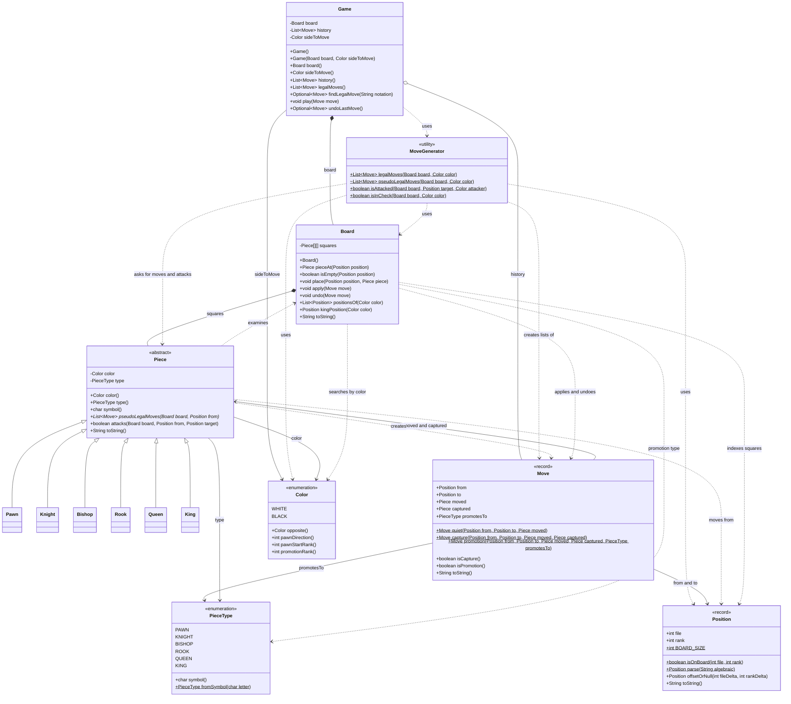

# CSC 413 Chess Engine Design

## Class Diagram

The following diagram shows the classes in the `engine` and `model` packages after M5.



## Sequence Diagram

The following diagram shows how `game.legalMoves()` works after M5. `MoveGenerator` first asks every piece for its pseudo-legal moves. It then temporarily applies each candidate move, checks whether the moving side's king is attacked, restores the board, and either keeps or drops the candidate.

```mermaid
sequenceDiagram
    actor Caller
    participant Game
    participant MoveGenerator
    participant Board
    participant Piece

    Caller->>Game: legalMoves()
    Game->>MoveGenerator: legalMoves(board, sideToMove)

    MoveGenerator->>MoveGenerator: pseudoLegalMoves(board, color)
    MoveGenerator->>Board: positionsOf(color)
    Board-->>MoveGenerator: occupied positions

    loop each position belonging to color
        MoveGenerator->>Board: pieceAt(position)
        Board-->>MoveGenerator: piece
        MoveGenerator->>Piece: pseudoLegalMoves(board, position)
        Piece-->>MoveGenerator: piece moves
    end

    MoveGenerator-->>MoveGenerator: candidate moves

    loop each candidate move
        MoveGenerator->